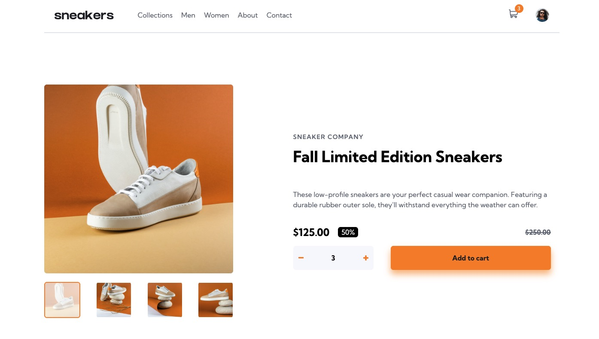

# 🛒 Product Page with Insta Cart

An interactive e-commerce product page built with **React**, **TypeScript**, and **Tailwind CSS**.  
Features dynamic product display, image gallery, cart management, discount pricing, and responsive design.

---

## 📸 Preview



LIVE: [https://p-glazowski.github.io/product-page](https://p-glazowski.github.io/product-page)

---

## 🚀 Features

- 🖼️ **Product Image Gallery** with multiple product images
- 💰 **Dynamic Pricing** showing original price and discount
- 🛍️ **Cart Management** - add/remove items with quantity control
- 📱 **Fully Responsive** - optimized for mobile and desktop
- 🔄 **Real-time Updates** - cart state syncs across components
- 🎨 **Modern UI** with smooth interactions and hover effects

---

## 🛠️ Tech Stack

- **React 18** (Context API for state management)
- **TypeScript** (full type safety)
- **Tailwind CSS** (responsive utility-first styling)
- **Vite** (fast development & builds)

---

## 📁 File Structure

```
src/
├── comps/
│   ├── CartProvider.tsx       # Shopping cart state & logic
│   ├── DataProvider.tsx       # Product data & context
│   ├── Header.tsx             # Navigation/header component
│   └── Product/
│       ├── Product.tsx        # Main product display
│       ├── Image.tsx          # Product image gallery
│       ├── Info.tsx           # Product details & info
│       ├── Price.tsx          # Dynamic pricing with discount
│       └── Controls.tsx       # Add to cart controls
├── App.tsx                    # Main app with providers
└── assets/
    ├── image-product-1.jpg
    ├── image-product-2.jpg
    └── ...
```

---

## 🧠 How It Works

- **DataProvider** supplies product data (sneakers with images, price, discount)
- **CartProvider** manages cart state with add/remove functionality
- **Product** component displays current product with real-time pricing
- **Context API** enables seamless state sharing between components
- **Responsive layout** adapts from mobile gallery to desktop side-by-side view

---

## 📦 Getting Started

1. **Clone the repository:**

   ```bash
   git clone https://github.com/p-glazowski/product-page.git
   cd product-page
   ```

2. **Install dependencies:**

   ```bash
   npm install
   ```

3. **Run development server:**
   ```bash
   npm run dev
   ```

---

## ✅ Future Improvements

- [ ] Image lightbox/zoom functionality
- [ ] Persistent cart with localStorage
- [ ] Multiple product variants (sizes, colors)
- [ ] Checkout flow integration
- [ ] Loading states and error handling

---

## 👨‍💻 Author

**p-glazowski**  
GitHub: [https://github.com/p-glazowski](https://github.com/p-glazowski)

---

## 📝 License

Open source under the [MIT License](LICENSE).
